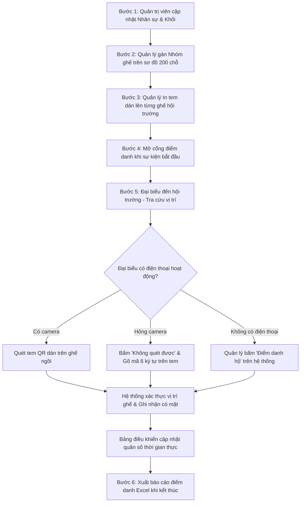

# 🏛️ HỆ THỐNG QUẢN LÝ CHỖ NGỒI & ĐIỂM DANH HỘI TRƯỜNG Z176

> **Ứng dụng Quản lý Sơ đồ Hội trường 200 ghế, Điều phối Chỗ ngồi & Điểm danh Thông minh theo thời gian thực.**  
> Xây dựng trên nền tảng **MERN Stack** (MongoDB, Express, React, Node.js) đạt chuẩn bảo mật, giao diện tối ưu đa thiết bị (Desktop / Máy tính bảng / Điện thoại).

---

## 📋 MỤC LỤC
1. [Giới thiệu tổng quan](#-giới-thiệu-tổng-quan)
2. [Tính năng nổi bật](#-tính-năng-nổi-bật)
3. [Kiến trúc & Công nghệ sử dụng](#-kiến-trúc--công-nghệ-sử-dụng)
4. [Cấu trúc thư mục dự án](#-cấu-trúc-thư-mục-dự-án)
5. [Quy ước sơ đồ & Ghế ngồi](#-quy-ước-sơ-đồ--ghế-ngồi)
6. [Tài khoản & Phân quyền hệ thống](#-tài-khoản--phân-quyền-hệ-thống)
7. [Hướng dẫn cài đặt & Khởi chạy](#-hướng-dẫn-cài-đặt--khởi-chạy)
8. [Quy trình vận hành sự kiện](#-quy-trình-vận-hành-sự-kiện)

---

## 🎯 GIỚI THIỆU TỔNG QUAN

Hệ thống được thiết kế đặc thù cho **Hội trường Z176** với quy mô chuẩn **200 chỗ ngồi** (10 hàng, mỗi hàng 20 ghế chia đều 2 bên cánh Trái/Phải), giải quyết triệt để các bài toán:
- **Sắp xếp chỗ ngồi theo khối/phòng ban**: Tránh nhầm lẫn, dễ dàng điều phối khu vực VIP và các đơn vị tham dự.
- **Điểm danh chính xác tại chỗ**: Ngăn chặn tình trạng điểm danh hộ từ xa thông qua mã QR bảo mật động gắn riêng trên từng ghế.
- **Phương án dự phòng toàn diện**: Hỗ trợ nhập mã tem thủ công (cho máy hỏng camera) và tính năng Điểm danh hộ có ghi nhật ký kiểm toán (cho đại biểu quên điện thoại).
- **Giám sát thời gian thực**: Quản lý và đại biểu theo dõi trực quan vị trí ghế, tỷ lệ có mặt theo khối/phòng ban.

---

## ✨ TÍNH NĂNG NỔI BẬT

### 1. Phân hệ Quản trị viên (Admin)
- **Dashboard KPI tổng quan**: Giám sát quân số, cơ cấu khối - phòng ban, tỷ lệ bố trí chỗ ngồi và tình trạng an toàn hệ thống.
- **Quản lý cơ cấu tổ chức (Khối & Phòng ban)**: Thiết lập cấu trúc doanh nghiệp linh hoạt, tự động liên kết với nhóm ghế.
- **Quản lý danh sách nhân sự**: Tìm kiếm, lọc theo phòng ban/khối, thêm mới, sửa, đổi mật khẩu và nhập danh sách từ file Excel.
- **Nhật ký hoạt động (Audit Logs)**: Ghi lại toàn bộ thao tác hệ thống (ai làm gì, lúc nào, chi tiết thay đổi) không thể sửa/xóa.
- **Sao lưu & Phục hồi (Maintenance)**: Xuất file JSON dự phòng và khôi phục dữ liệu toàn vẹn khi cần.

### 2. Phân hệ Quản lý Vận hành (Manager)
- **Sắp xếp chỗ ngồi trực quan 2D**:
  - Gán nhóm ghế nhanh theo từng hàng (20 ghế) hoặc chỉnh sửa từng ghế lẻ.
  - Bảng màu nhận diện lên tới 18 màu sắc rõ nét.
  - Thước kẻ chỉ số cột ghế (`10..1` bên Trái, `1..10` bên Phải) gióng thẳng xuống từng ghế giúp điều phối không bao giờ nhầm.
  - Thẻ tiến độ sắp ghế hiển thị tỉ lệ % và số ghế còn trống theo thời gian thực.
- **Quản lý Nhóm hội trường**:
  - Tạo nhanh nhóm ghế 1-click từ Khối có sẵn hoặc tạo nhóm tùy biến.
  - Thiết lập quy định nhóm có bắt buộc điểm danh hay không (VD: Khách mời, VIP miễn điểm danh).
- **Giám sát Điểm danh trực tiếp**:
  - Thống kê tỷ lệ có mặt theo thời gian thực theo Khối hoặc theo Phòng ban.
  - Bộ lọc đa tiêu chí: Khối, Phòng ban, Nhóm ghế, Trạng thái (Đã/Chưa điểm danh).
  - Xuất báo cáo điểm danh ra file Excel (`.xlsx`) chuẩn hóa.
  - **Điểm danh hộ**: Quản lý có thể xác nhận điểm danh cho đại biểu quên điện thoại kèm ghi chú lý do và lưu vết kiểm toán.
- **Cài đặt Sự kiện & In ấn Tem QR**:
  - Mở/Đóng cổng điểm danh.
  - In tờ hướng dẫn quét QR A4 dán tại cửa vào.
  - **In tem dán ghế 3 kích cỡ chuẩn A4**:
    - Cỡ tiêu chuẩn (24 tem/trang).
    - Cỡ lớn rõ nét (12 tem/trang - QR kích thước lớn, chuẩn sửa lỗi cao).
    - Cỡ cực đại (6 tem/trang).
  - Mỗi tem in rõ: Số hàng, Cánh Trái/Phải, Số ghế, Mã QR và dòng **Mã bảo mật 6 ký tự** in to dưới QR.

### 3. Phân hệ Đại biểu / Người tham dự
- **Tra cứu chỗ ngồi nhanh**: Đăng nhập bằng Mã nhân viên hoặc số định danh.
- **Sơ đồ dẫn đường thông minh**: Bản đồ 2D và sơ đồ rút gọn mobile hiển thị nổi bật khu vực ghế của mình, đường nét đứt dẫn lối từ Cửa vào.
- **Quét mã điểm danh tại ghế**:
  - Quét camera trực tiếp vào tem QR dán trên ghế.
  - Cơ chế chống quét nhầm: Tự động cảnh báo nếu quét trúng QR dán cửa thay vì tem ghế.
- **Nhập mã ghế thủ công (Không quét được)**:
  - Nếu điện thoại hỏng camera hoặc tem mờ: Người dùng chỉ cần gõ đúng 6 ký tự in trên tem ghế để xác nhận có mặt.
  - Tự động kiểm tra: Nếu nhập mã của ghế thuộc nhóm khác, hệ thống sẽ từ chối và hướng dẫn về đúng vị trí được phân bổ.

---

## 🛠️ KIẾN TRÚC & CÔNG NGHỆ SỬ DỤNG

### Phân hệ Client (`client/`)
- **Core**: React 18 / 19, Vite 6.x.
- **Routing**: React Router DOM v7 (kiểm soát tuyến đường theo vai trò `RequireRole`).
- **Styling**: Tailwind CSS v4, Lucide React Icons.
- **Thư viện chuyên dụng**:
  - `html5-qrcode`: Xử lý quét mã QR từ camera đa thiết bị.
  - `qrcode.react`: Tạo mã QR SVG/Canvas độ nét cao cho in ấn tem ghế.
  - `xlsx`: Đọc và xuất file báo cáo bảng tính Excel.
  - `axios`: Kết nối API Backend với Interceptors quản lý phiên token.

### Phân hệ Server Backend (`server/`)
- **Core**: Node.js (>=20), Express 5.x (ES Module).
- **Cơ sở dữ liệu**: MongoDB với Mongoose 9.x ODM.
- **Bảo mật & Kiểm soát**:
  - **JWT (JSON Web Token)**: Xác thực phiên đăng nhập không trạng thái (stateless).
  - **Bcryptjs**: Băm mật khẩu quản trị chuẩn một chiều an toàn.
  - **Helmet & CORS**: Bảo vệ HTTP Headers và kiểm soát truy cập chéo nguồn.
  - **Express Rate Limit**: Chống spam quét mã và brute-force đăng nhập (giới hạn theo mã NV để tránh ảnh hưởng mạng nội bộ công ty).
  - **Audit Logging**: Module ghi nhật ký tự động mọi thao tác nhạy cảm.

---

## 📁 CẤU TRÚC THƯ MỤC DỰ ÁN

```text
hoitruongz76/
├── client/                     # Mã nguồn giao diện người dùng (Vite + React)
│   ├── src/
│   │   ├── components/         # Linh kiện giao diện UI chuẩn hóa
│   │   │   ├── attendance/     # ScannerModal (quét QR / nhập mã ghế thủ công)
│   │   │   ├── audit/          # Bộ lọc & danh sách nhật ký hoạt động
│   │   │   ├── employees/      # Form thêm/sửa, bảng nhân viên, import Excel
│   │   │   ├── groups/         # Modal tạo nhóm ghế (chế độ nhanh & tùy biến)
│   │   │   ├── hall/           # HallMap 2D, Seat SVG, Thước đo, Lối đi giữa
│   │   │   └── ui/             # Select (chống tràn), Button, Modal, Badge, Toast
│   │   ├── constants/          # Quy chuẩn 200 ghế, bảng 18 màu, vai trò
│   │   ├── context/            # AuthContext, ToastContext, ConfirmContext
│   │   ├── hooks/              # Custom hooks dữ liệu (useAttendance, useOrg,...)
│   │   ├── layouts/            # AdminLayout (Staff) & AttendeeLayout (Mobile)
│   │   ├── pages/
│   │   │   ├── admin/          # Dashboard, Quản lý Nhân sự, Cơ cấu, Audit, Sao lưu
│   │   │   ├── attendee/       # Đăng nhập tra cứu, Xem ghế & Quét điểm danh
│   │   │   ├── auth/           # Đăng nhập bảo mật cho Admin / Manager
│   │   │   └── manager/        # Sắp chỗ 2D, Nhóm ghế, Giám sát Điểm danh, In tem QR
│   │   ├── services/           # Axios API services kết nối Backend
│   │   └── utils/              # Định dạng nhãn ghế, kiểm tra check-in, CSS in ấn
│   └── package.json
│
├── server/                     # Máy chủ API Backend (Node.js + Express + MongoDB)
│   ├── src/
│   │   ├── config/             # Kết nối MongoDB, kiểm tra biến môi trường .env
│   │   ├── constants/          # Hằng số hội trường, định nghĩa phân quyền Roles
│   │   ├── controllers/        # Attendance, Auth, Employee, Event, Group, Org, Seat
│   │   ├── middleware/         # Xác thực JWT, phân quyền Role, bắt lỗi tập trung
│   │   ├── models/             # Mongoose Schemas (Seat, Employee, Attendance, Audit,...)
│   │   ├── routes/             # Định tuyến RESTful API (/api/*)
│   │   ├── scripts/            # Script tạo dữ liệu mẫu ban đầu (seed)
│   │   └── utils/              # Bộ sinh mã token 6 ký tự ngẫu nhiên, ghi audit
│   ├── server.js               # Khởi chạy Express server
│   ├── .env                    # Cấu hình cổng, chuỗi kết nối MongoDB, Secret Key
│   └── package.json
│
├── structure/                  # Tài liệu phân tích kỹ thuật chi tiết
│   ├── client.md               # Đặc tả chi tiết phân hệ Frontend
│   └── server.md               # Đặc tả chi tiết phân hệ Backend & RESTful API
└── package.json                # Script npm root điều khiển chạy song song
```

---

### 🔐 Quản lý mật khẩu & Khôi phục tài khoản

1. **Quản lý / Quản trị viên tự đổi mật khẩu**:
   - Khi đã đăng nhập, bấm nút **"Đổi MK"** ở góc phải thanh tiêu đề (Header).
   - Nhập mật khẩu hiện tại $\rightarrow$ Nhập mật khẩu mới (tối thiểu 8 ký tự) $\rightarrow$ Xác nhận để lưu.

2. **Quản trị viên (Admin) đặt lại mật khẩu cho Quản lý**:
   - Admin truy cập trang **Quản lý Nhân sự** (`/admin/employees`).
   - Tìm tài khoản Quản lý $\rightarrow$ Bấm nút cây bút **Sửa** $\rightarrow$ Điền mật khẩu mới vào ô "Mật khẩu" $\rightarrow$ Bấm Lưu.

3. **Trường hợp Quản trị viên (Admin) bị quên mật khẩu**:
   - Vì hệ thống chạy mạng nội bộ Intranet (không cấu hình gửi mail ngoài), hệ thống trang bị công cụ Terminal an toàn trực tiếp từ Server:
   ```bash
   cd server
   npm run reset-admin <MậtKhẩuMớiCủaAdmin>
   # Ví dụ: npm run reset-admin Admin@2026!
   ```
   Lệnh sẽ tự động băm bảo mật bcrypt và cập nhật mật khẩu mới ngay lập tức mà không làm mất bất kỳ dữ liệu sự kiện nào.

---

## 🪑 QUY ƯỚC SƠ ĐỒ & GHẾ NGỒI

Hội trường gồm tổng cộng **200 chỗ ngồi**:
- **Quy mô**: 10 hàng ghế (từ Hàng 1 đến Hàng 10).
- **Phân bổ**: Mỗi hàng gồm 20 ghế:
  - **Cánh Trái (L)**: 10 ghế (mã từ `L-1` đến `L-10`).
  - **Cánh Phải (R)**: 10 ghế (mã từ `R-1` đến `R-10`).
- **Quy tắc đếm số ghế**:
  - Ghế số **1** luôn nằm ở mép **Sát lối đi giữa** của hội trường.
  - Số ghế tăng dần từ **1 đến 10** khi đi dần về phía **Sát tường**.
  - Ví dụ mã ghế chuẩn: `5-L-3` (Hàng 5, Bên Trái, Ghế số 3 từ lối đi ra).
- **Hàng ưu tiên**:
  - Hàng 1 & Hàng 2: Hàng ghế VIP (Trưởng ban & Lãnh đạo cấp cao).
  - Hàng 3 đến Hàng 10: Hàng ghế tiêu chuẩn phân bổ cho các khối và khách mời.
- **Mã bảo mật ghế (Seat Token)**:
  - Gồm 6 ký tự chữ hoa và số.
  - Bảng ký tự loại bỏ các chữ dễ nhầm: `I, O, 0, 1` (chỉ dùng `ABCDEFGHJKLMNPQRSTUVWXYZ23456789`).

---

## 🔐 TÀI KHOẢN & PHÂN QUYỀN HỆ THỐNG

| Vai trò | Phân vùng truy cập | Quyền hạn chính |
|---|---|---|
| **ADMIN** (Quản trị viên) | `/admin/*` | Toàn quyền quản trị nhân sự, cơ cấu tổ chức, sao lưu phục hồi và xem nhật ký audit log. |
| **MANAGER** (Quản lý) | `/manager/*` | Sắp xếp vị trí 200 ghế, quản lý nhóm, in tem QR, theo dõi điểm danh và điểm danh hộ. |
| **EMPLOYEE** (Nhân viên) | `/login`, `/seat` | Tra cứu vị trí ghế chỉ định theo sơ đồ 2D, quét mã QR hoặc nhập mã tem để điểm danh. |
| **GUEST** (Khách mời) | `/login`, `/seat` | Tra cứu chỗ ngồi khu vực khách mời (mặc định không bắt buộc quét điểm danh). |

### Tài khoản mẫu ban đầu (khi chạy Seed dữ liệu)
- **Quản trị viên**: Mã `` / Mật khẩu: ``
- **Quản lý hội trường**: Mã `` / Mật khẩu: ``
- **Nhân viên mẫu**: Mã `NV001` đến `NV008` (đăng nhập trực tiếp bằng mã, không cần mật khẩu).

---

## 🚀 HƯỚNG DẪN CÀI ĐẶT & KHỞI CHẠY

### 1. Yêu cầu môi trường
- **Node.js**: Phiên bản 20.x trở lên.
- **MongoDB**: Phiên bản 6.x trở lên (đang chạy tại máy local hoặc MongoDB Atlas).
- Trình quản lý gói: `npm`.

### 2. Cài đặt Dependencies
Cài đặt thư viện cho cả Root, Client và Server:

```bash
# Cài đặt tại thư mục gốc
npm install

# Cài đặt dependencies cho Client
cd client && npm install

# Cài đặt dependencies cho Server
cd ../server && npm install
cd ..
```

### 3. Cấu hình Biến môi trường (`.env`)
Kiểm tra file `server/.env`:
```env
PORT=5000
MONGO_URI=mongodb://127.0.0.1:27017/hoitruongz76
CLIENT_ORIGIN=http://localhost:3000
JWT_SECRET=your_super_secret_jwt_key_here
SEED_ADMIN_PASSWORD=
SEED_MANAGER_PASSWORD=
```

Kiểm tra file `client/.env` (nếu cần thay đổi cổng API):
```env
VITE_API_URL=/api
```

### 4. Khởi tạo dữ liệu mẫu (Seed Database)
Nạp cấu trúc hội trường 200 ghế, các khối, phòng ban và tài khoản mẫu vào MongoDB:

```bash
# Nạp dữ liệu mẫu an toàn (không ghi đè nếu đã có dữ liệu)
npm run seed:server

# HOẶC buộc làm mới dữ liệu từ đầu (Reset trắng và tạo lại mẫu chuẩn Z176)
npm run seed:force
```

### 5. Khởi chạy ứng dụng
Chạy song song cả Backend Server và Frontend Client:

```bash
# Chạy Backend (chạy tại cổng 5000)
npm run dev:server

# Mở một cửa sổ dòng lệnh khác, chạy Client (chạy tại cổng 3000)
npm run dev:client
```

Mở trình duyệt truy cập:
- **Giao diện Đại biểu / Điểm danh**: [http://localhost:3000/login](http://localhost:3000/login)
- **Cổng Đăng nhập Quản trị & Quản lý**: [http://localhost:3000/quan-tri/login](http://localhost:3000/quan-tri/login)

---

## 🔄 QUY TRÌNH VẬN HÀNH SỰ KIỆN



---

## 🛡️ AN TOÀN & BẢO MẬT HỆ THỐNG
1. **Kiểm tra chéo vị trí ghế**: Người tham dự không thể quét mã của ghế nhóm khác để điểm danh thay. Hệ thống tự động so khớp Khối $\rightarrow$ Nhóm được phân bổ $\rightarrow$ Ghế thực tế.
2. **Không thể giả mạo dữ liệu gửi lên**: Danh tính người điểm danh được trích xuất trực tiếp từ JWT Token của phiên, không nhận mã gửi từ Client.
3. **Mã token ghế bảo mật cao**: Thuộc tính `token` của ghế được cấu hình `select: false` trong cơ sở dữ liệu, chỉ được gọi ra khi tạo trang in tem và khi so khớp điểm danh.
4. **Nhật ký kiểm toán minh bạch**: Bất kỳ hành động sửa nhân sự, thay đổi sơ đồ ghế hay điểm danh hộ đều lưu vết IP, danh tính cán bộ thực hiện và lý do cụ thể.

---
*Phát triển và vận hành phục vụ các hội nghị, sự kiện tiêu chuẩn tại Hội trường Z176.*

